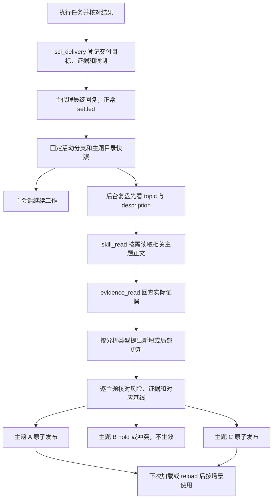

# 项目 Skill 自动沉淀

## 架构与边界

已实现可选的“交付点快照 → 独立后台 SDK 会话 → 按分析类型归类 → 项目 skills 增量发布”。
不在主界面执行 `/fork`，不改变主会话 ID、历史或工具选择，不依赖 Herdr/tmux 派工。
两层技能仍是：项目内自动生长；`scientist/skills/` 由维护者人工提炼，代码不写它。

**一个项目可以有多个 skill，不再使用一个大文件容纳所有分析。** 例如：

```text
<project>/.pi/skills/
  sample-alignment/SKILL.md
  single-cell-qc/SKILL.md
  cell-annotation/SKILL.md
  differential-expression/SKILL.md
  spatial-neighborhoods/SKILL.md
```

目录名和 frontmatter 的 `name` 直接使用主题名称，不加项目名、scientist 前缀或路径哈希。
这些是示例，不预建目录，也不强制固定分类。按独立可复用的分析类型/工作流程分组，不按 Task、日期或数据集逐次新建。
匹配现有主题优先；发现相似主题时先读取，避免重复。真正独立的能力才新建，并为每个 skill 编写自己的触发描述。
语义归类依赖模型判断，不宣称能用主题字符串完全消除同义重复。

仍只有两个生产模块：

- `core/learning.ts`：交付登记、活动分支快照、目录提示、按需读取、独立 SDK 会话与生命周期。
- `core/learning-store.ts`：主题快照、文本证据、提案格式、逐 skill 发布、冲突检查与回退。

默认关闭。启用使用用户命令，不提供模型可调用的启用入口。后台使用当前物理模型及 thinking level，会产生额外费用。
历史 `PROJECT-MEMORY-DESIGN.md` 不作为现行规则。

## 使用

在明确的分析项目根目录启动 Pi，信任项目后：

```text
/sci-learn on                      启用当前 cwd 项目的自动学习
/sci-learn status                  查看主题目录、当前进程任务和最近五条记录
/sci-learn reflect                 手动复盘当前分支最近一次交付或纠正
/sci-learn reflect 样本对齐交付       显式指定要复盘的交付
/sci-learn off                     停止新学习并取消当前复盘，已有技能保留
/sci-learn rollback <run-id> [topic] 回退一个主题；一轮包含多项发布时必须指定 topic
```

根目录为当前 cwd 的真实路径，不猜 Git 根或父项目，子目录会话不会自动继承父目录配置。
新配置只记录 `enabled`，技能名称不依赖项目路径，移动项目不需要重命名技能。历史带路径哈希的配置迁移到不同根目录时，需先人工核对并替换为新配置。
`off` 不停用已发布技能；停用它们使用 Pi 资源筛选。

## 流程



一次交付可产生零个、一个或多个主题变更。**同一主题内保守整组检查，不同主题独立发布**。
一项 hold/失败不阻塞其他独立主题；部分成功返回 partial，并在结果里逐项列出状态。
不自动执行跨主题依赖的移动、重命名、合并删除或旧混合技能拆分，避免一边失败造成知识丢失。这类整理需要人工协调。

自动化依赖明确登记：启用后提示主代理在实质性交付末尾调用 `sci_delivery`，不是通过“完成了”、文件存在、idle 或每轮 `agent_end` 猜测。
漏登记可用 reflect 补做。登记不是科学验收结论，失败任务中已验证的局部经验也可学习。
主运行取消/错误则丢弃本轮待启动登记并通知，不在未来无关任务末尾补触发。
同一扩展实例最多一个待启动或运行中的复盘，繁忙时明确拒绝，不暗建任务队列。交付键去重；手动 reflect 是新的尝试。

## 上下文与工具

快照来自 `getBranch()`，保留活动分支的压缩与 context edit，不复制放弃的旁支或之后的新任务。
原始 snapshot 不变，后续复盘消息写入独立 session 文件。Pi 仍按压缩和 context edit 重建模型上下文，并非所有原文都会直接进入模型。

目录快照保存每个主题的原文基线，但**提示词只放 topic、description、路径和可写状态，不把全部技能正文灌入上下文**。
复盘通过 `skill_read(topic)` 获取需要的快照正文；修改已有主题前必须实际调用它，宿主会校验。
目录扫描项目 `.pi/skills/` 下符合主题命名规则的直接子目录，人工技能只读；不跟随链接目录，不扫描全局技能。旧前缀技能仍可只读识别；同主题短名与旧名并存时禁止自动更新，需先人工协调。

复盘重新构建系统提示词及工具集合，不自动发现插件、MCP、skills 或 AGENTS 文件，不继承主代理的可执行权限。
仅有两个工具：

- `skill_read`：读取目录中主题的冻结正文；是既有指导，不是新独立证据。
- `evidence_read`：读取项目内非私有目录的文本产物；拒绝越界路径、越界/私有符号链接、二进制及超过 128 KiB 的文件。

无 shell、写入、edit、网络工具或递归派工入口。模型不能直接发布。
两种读取合计最多 16 次、8 个模型轮次、5 分钟；不重跑分析。大数据或图片需要已有的小型验证记录，否则保留待核实。
这是工具能力限制，不是对同机恶意进程的操作系统沙箱。

## 提案与发布

```json
{
  "summary": "本次归类与更新理由",
  "skills": [{
    "topic": "single-cell-qc",
    "description": "本项目单细胞输入质控；检查原始计数矩阵或准备过滤步骤时使用。",
    "changes": [{
      "oldText": "原正文中唯一匹配的片段；空字符串表示追加",
      "newText": "带适用条件、动作、验证方式和来源的局部替换",
      "reason": "为什么改",
      "disposition": "eligible",
      "changesScientificDecision": false,
      "evidence": [{"path": "模块/验证记录.txt", "quote": "实际读取过的精确原文"}]
    }]
  }]
}
```

- `skills=[]` 不更新、不创建空技能；无新知识还是缺证据必须在 summary 说明。
- 一次最多八个主题，每个主题最多八项修改；每个正文独立限制为 24,000 字符，不是整个项目共用额度。
- topic 为最多 40 字符的小写 kebab-case，现有主题保持标识，`legacy` 保留为只读；路径由宿主生成，不接受模型指定任意输出路径。
- 每个 skill 有独立 description，JSON 引号编码后作为合法 YAML 字符串写入，避免前言注入；名称和所有权元数据由宿主固定。
- 一个主题内有 hold 或科学决策变更则整组 hold；不影响其他主题。
- eligible 只是模型认为可进入宿主检查。宿主核对引文已读/精确匹配、证据版本未变、**该主题**基线未变、原文唯一且修改不重叠。
- 新主题发布前必须确认目标仍不存在；只允许更新带本系统格式/所有权标记的主题，其他同名文件只读。
- 发布/回退共用项目短锁，但基线按主题独立比较；无关主题变化不会让当前补丁失效。
- 每个主题发布前保存 before/after，再临时文件 rename；不生成脚本、不自动 commit/push。

宿主校验的是结构与来源，**不是独立科学审核**。风险归类仍由模型负责；真实引文不保证正确解释。
用户决定、执行成功与科学证据必须区分；后续发现误导要纠正或回退。

## 存储、兼容与恢复

```text
<project>/.sci/learning/
  config.json                      enabled（不再保存命名空间或路径哈希）
  publish.lock                     发布/回退期间持有
  runs/<run-id>/
    job.json                       来源 session/leaf、交付与主题原文基线
    snapshot.jsonl                 截至交付点的只读活动分支快照
    session.jsonl                  复盘自身历史
    response.txt / proposal.json   模型原文与主题化提案
    evidence.json / usage.json     证据摘要哈希与本次模型调用量
    publication.json               各主题状态、before/after 与目标路径
    result.json                    整体结果及各主题状态
    rollback-<topic>.json           对该主题的显式回退记录
```

目录与文件按私有权限创建；完整快照仍可能包含主会话敏感信息，不要公开提交 `.sci/learning/`，按项目隐私规则保管和清理。
候选与历史不注册为技能。各已发布主题使用 Pi 原有 `.pi/skills/` 发现机制，遵守资源筛选与信任设置，不添加隐式发现 hook。
新主题下次加载或用户 `/reload` 后发现，不自动改变正在执行的主会话依据。

**旧版兼容**：`{enabled, skill}` 和 `{enabled, namespace}` 配置仍可读取，on/off 时写为 `{enabled}`。旧混合单文件保留为 `legacy` 只读项；旧前缀主题也只读，不自动生成同主题副本或覆盖短名冲突。需要迁移时先核对重名，再人工修改目录和 frontmatter name；不自动改动已有项目文件。旧发布回退仍只作用于原目标路径。
启用学习不要求项目没有人工 skill；普通人工文件仍只读，只有匹配自动维护标记和格式的技能才可更新。与全局技能同名时遵循 Pi 的原有冲突诊断，必要时使用更具体的语义名称，而非自动加技术前缀。

关闭、切换或 reload 主会话会取消后台复盘并留记录；不是独立守护进程。
强杀可能留下 running 或 publish.lock；核对 ownerPid/进程与 before/after，不自动抢锁。确认所有发布者退出后才人工清理残锁。
多主题发布中断可能只有部分文件已更新，逐主题比较 publication.json 与实际内容，不假设整批全成或全败。
回退必须指向一个主题且当前内容仍等于那次发布，不能覆盖后来的修改，也不影响其他 skill。
失败或冲突后可 reflect 在当前历史和新目录上重试；没有自动重试循环。

## 验证与限制

见[验收与消融](project-skill-learning-cases.md)。仍不建向量库、常驻 MEMORY、通用队列、第二审核代理、多文件事务或自动跨项目晋升。
虚拟路由模型暂不支持；独立 runtime 复用配置/凭据存储及已注册 provider 配置，不承诺继承仅内存注入的认证。
没有自动脱敏；本系统是项目操作经验维护，不是科研结论自动裁决系统。
